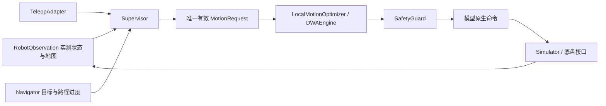

# 架构与 API 迁移

本轮实现对应 `assets/pyrobo_refactor_final.md` 的阶段 A–E。全向、双阿克曼、MPC 和硬件协议属于后续扩展。

## 运行链路



| 模块 | 职责与边界 |
| --- | --- |
| `core` | 状态、原生命令、意图、路径、时序轨迹、枚举、诊断；不依赖算法 |
| `models.kinematics` | 车型能力、批量搜索坐标到原生命令的映射 |
| `models.dynamics` | 唯一的有限力积分器、列布局 codec、批量诊断、预测与可达响应估计 |
| `geometry` | 原始点云的空间索引、矩形距离、连续扫掠；不判断控制模式 |
| `planning` | `GlobalPlanner`，RRT-Connect、Voronoi + D* Lite |
| `control.dwa` | 采样、批量预测、硬掩码、代价和选优；三个策略共用同一流水线 |
| `navigation` | 目标、全局路径缓存、可回退进度、重规划和到达条件 |
| `teleop` | 将外部输入转为有期限的期望；阿克曼低速时保留明确的转向意图 |
| `runtime` | 输入来源权限、AUTO/MANUAL/PAUSED/ESTOP、超时和控制权 |
| `safety` | 独立复核最终指令的一周期执行及制动，不信任优化器的安全标记 |
| `simulation` / `adapters` | 实体碰撞与执行、外部命令表示能力；不复制物理方程 |

具体默认算法的构造集中在 `navigation/defaults.py`。`navigator.py` 只使用规划器和优化器协议；`observe()` 不运行 DWA。共享弧长跟踪位于 `navigation/tracking.py`，不依赖 Navigator。核心导入不打开窗口、启动线程或执行文件 I/O。

## 推荐入口

```python
from pyrobo import (
    Ackermann, Navigator, RobotObservation, Supervisor, ControlMode,
    MotionPolicy, Twist2D,
)
from pyrobo.simulation import Simulator2D, demo_world

world, start, goal = demo_world()
nav = Navigator(model=Ackermann())
runtime = Supervisor(nav, authorized_sources=("operator",))
runtime.set_goal(goal, timestamp=0.)
sim = Simulator2D(world, start, model=nav.model, footprint=nav.footprint,
                  dynamics=nav.dynamics.config)
cloud = world.point_cloud()  # 静态地图不带时间戳

# 每个周期使用同一份完整实测状态。手动时也更新导航进度。
state = sim.state
runtime.set_mode(ControlMode.MANUAL)
runtime.submit_teleop(Twist2D(.5, 0.), state.timestamp,
                      steering=.2, policy=MotionPolicy.TELEOP_STOP)
result = runtime.step(RobotObservation(state, cloud, world.bounds, dt=.1))
sim.step(result.command, .1)

runtime.set_mode(ControlMode.AUTO)  # 不重置速度、转角、加速度或历史路径
```

`Supervisor.step()` 返回 `MotionResult`；其 `command` 才是可执行指令。调用者可以用 `Navigator.navigation_output(observation, result)` 取得兼容导航视图。`Navigator.step(NavigationInput(...))` 仍是自动导航的便捷入口，也经过最终安全门。

若需要替换算法，传 `Navigator(global_planner=..., local_optimizer=..., model=..., dynamics=...)`。全局规划器只需实现 `plan(start, goal, collision_world, bounds) -> PlanResult`，局部优化器实现 `optimize(observation, request) -> MotionResult`。`reset()` 为可选生命周期能力。共享模型、矩形和物理参数须一致；`NavigationConfig` 可独立控制前视和到达容差，默认从兼容的 DWA 配置取值。

## 三种策略的硬约束

| 策略 | 纵向搜索域 | 角向参考 | 优化依据 |
| --- | --- | --- | --- |
| `NAVIGATION` | 模型范围，可配置禁倒车 | 车型允许的转向 | 前视目标、路径、航向、速度、间距 |
| `TELEOP_STOP` | 0 到用户速度，不超幅、不自行反向 | 差速固定 ω；阿克曼固定 δ | 保持期望、平滑、间距 |
| `TELEOP_AVOID` | 同 STOP；零速期望不自动平移 | 期望附近的有界偏离 | 保持输入、绕障、平滑与短时转向迟滞 |

`max_turn_deviation` 单位取决于车型：差速 rad/s，阿克曼 rad。AVOID 还按预测时刻约束相对用户期望圆弧的 `max_lateral_deviation`（m）和 `max_heading_deviation`（rad），不隐式创建导航目标。参考速度约束并不要求实际速度瞬间变化。

当严格保留转向不可行时，停止策略会明确返回安全覆盖 `safety_override=True`，允许制动同时消除转动。无候选不等于可以安全停车：实际 estop 也要预测。AVOID 是局部辅助，不保证穿越整个障碍或自动回到操作前的世界朝向。

阿克曼 Twist 反解在低速区（默认 |v|<0.02 m/s）不做除法：必须有显式转角或上次有效转角；首次零速非零 ω 会被拒绝。底盘输出需要 Twist 时可用 `TwistCommandAdapter`，但它会拒绝 Twist 无法表示的原地转角和 coast/soft_stop/estop 模式。

## 批量数据与可达性

热路径保留 `search: (N,U_search)`、`native: (N,U_native)`、`states: (N,T,S)`、`masks/costs: (N,)`。差速搜索 `(v,ω)`，一次映射到左右轮速；阿克曼搜索 `(v,δ)`。只有获选的一行转换为命令对象和 graphmap 时序轨迹。`StateCodec` 定义状态列；控制和碰撞层只取 codec 提供的位姿与速度视图。

`ReachabilityEstimator.state_envelope()` 使用真实 `integrate(..., mode='track')` 试探，包含伺服、jerk、被动阻力与力预算。这是**经验响应范围**，`strict_outer_bound=False`，不能用作拒绝候选的严格外包络。`command_window()` 保留模型和意图允许的完整命令范围，用响应代表点补充采样锚点；估计失败保留搜索域并报告 `window_fallback`。高目标值可能无法在一周期达到，却仍是有用的饱和驱动命令。

`track` 的零速参考是含 jerk 的速度伺服，`estop` 是有限力制动，两者不能互代。整个预测时域和“一周期后立即制动”分别验证。`RolloutBatch.times` 为相对时间；`prediction_end` 标识保持指令段末端，后面为制动尾段；`valid_time_mask` 排除每行已经停住后的填充。`Trajectory.timestamps` 是绝对时戳，`states` 是可选的只读数值样本。

`integrate(..., diagnostics=True)` 返回 `(states, BatchDiagnostics)`；默认仍返回数组。每类诊断都是 `(N,)`，可以对应候选行号。`reference_limited` / `effort_limited` 表示执行器限幅，不自动否定安全的受限响应。横向包络默认记录，`DWAConfig(reject_lateral_violation=True)` 可将其变为硬掩码。`collect_batch_diagnostics=True` 开启诊断跟踪。

`DWAConfig(batch_size=...)` 分块预测和评分，降低轨迹工作集内存；采样矩阵仍完整生成。默认 0 为整批。块内仍是数组运算，稳定行号与平分规则保证相同候选网格的结果一致。扩展车型需提供 CommandSpace、StateCodec、BatchDynamics 和适合该搜索域的策略；测试包含 U=3、S=7 的替代模型。

## 控制权与故障

- MANUAL 仅选择授权来源的最新有效期望；默认 TTL 为 0.3 s，过期制动，不切回自动。
- AUTO 可选 `auto_task_ttl`；使用 `set_goal` 或 `renew_task` 明确续期。
- PAUSED 制动并保留任务。ESTOP 锁存；普通 `set_mode(AUTO)` 不能解除，须 `release_estop()`，解除后进入 PAUSED 并清除旧手动请求。
- 手动期间 Navigator 只观察和维护路径，不额外求解自动控制；返回 AUTO 时复用完整历史路径。倒退使弧长进度回退，新障碍仍会使相关路径失效。
- SafetyGuard 独立编码最终原生命令，并模拟一周期及制动。状态、地图、请求陈旧，控制周期不匹配或超过命令看门狗期限，命令适配失败或模型异常，均输出明确的停止原因。输入错误不会包装成“已验证安全”。

`MotionStatus` 描述运动结果，`SafetyAction` 描述干预，`SafetyAssessment` 描述证据。`safe_under_model` 只表示当前点云、矩形、模型和制动预算下通过检查。制动未经证明时为 `braking_unverified`；陈旧观测为 `input_stale`；不合法模型/表示为 `model_invalid`。`Diagnostics` 保存候选数、可行数、间距、请求与选中命令、各项代价、退化原因和扩展数据。最终安全门拒绝上游输出时保留 `upstream_reason`。

## 兼容迁移

| 旧入口 | 当前定义 / 推荐入口 |
| --- | --- |
| `pyrobo.types` | `core.geometry/state/footprint/obstacles` |
| `pyrobo.kinematics` | `models.kinematics` + `core.commands` |
| `pyrobo.dynamics` | `models.dynamics` + `core.state` |
| `pyrobo.pointcloud` | `core.obstacles` + `geometry.collision` |
| `pyrobo.motion` | `models.dynamics.integration` |
| `pyrobo.navigation` | 同名包，原有类名与 step 签名保留 |
| `DynamicWindow.step/stop` | 共享 DWAEngine 的兼容包装；新入口为 `optimize` |
| `control.dwa.path` | `navigation.tracking` 的兼容导出 |
| `PlanResult.path` | 继续返回 PoseArray；新增 `route` 返回 Path |
| `NavigationOutput.path/trajectory` | 兼容 PoseArray；新 MotionResult.trajectory 为有时间的 Trajectory |
| `run_navigation(command_override=...)` | 已弃用，仍经安全门；改用 `control_input(k, state, supervisor)` |

兼容模块只做导出，不保留第二套物理或控制实现。所有旧状态字符串仍可比较；新状态使用 `StrEnum`。`command_override` 仅用于旧实验重放，不能绕过最终检查；正式手动例程和 handoff CLI 均经 Supervisor → MotionRequest → DWA。

## 验证与性能

```bash
python -m pytest -q
python -m examples.assisted_teleop                 # 两种车型 × 四种场景
python -m pyrobo.simulation --scenario handoff --model ackermann
python -m scripts.benchmark_control --output benchmarks/after.json
```

重构前的动力学数值保存在 `tests/data/dynamics_baseline.npz`，测试不在运行时重新生成参考值。性能基线、比较口径与结果见 [benchmarks](../benchmarks/README.md)。
