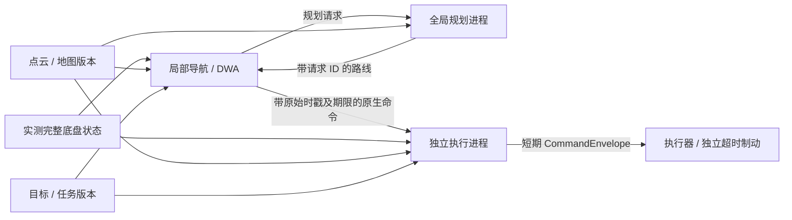

# RSim 导航组件

可选的 RSim 集成把全局规划、DWA 和最终执行检查放进三个独立组件。核心 `import pyrobo` 不加载 RSim，也不启动进程。只导入本子包时需要安装真实的 RSim 源码库；不要用同名的未知 PyPI 包替代。

## 运行

RSim 当前要求 Python ≥3.12；pyrobo 核心仍要求 Python ≥3.11。先在同一环境配置 graphmap，再按 RSim 自身说明安装：

```bash
python -m pip install -e '/path/to/RSim[dds]'
python -m rsim.apps.doctor --require process,shared-mapping,dds --deep --json
python -m examples.navigation_benchmark.rsim_platform --scenario narrow_ackermann \
  --model ackermann --planner rrt_connect --output reports/narrow.json
```

多进程需要 Cyclone DDS、cloudpickle 和 RSim 的共享映射支持；`--local` 使用同一组件图及线程计算，不需要 DDS。这里运行虚拟底盘，不连接实体设备。

## 组合

```python
from rsim import Connect, Runtime
from pyrobo import Ackermann
from pyrobo.integrations.rsim import NavigationStack, StackConfig

# states / maps / missions 是调用方提供的 RSim Signals。
stack = NavigationStack(states, maps, missions, StackConfig(model=Ackermann()))
drive = Connect(stack.commands, actuator.command, ttl=.1, hz=100)
async with Runtime(stack.diagnostics, drive, placement=stack.placement()):
    frame = await stack.diagnostics.get(timeout=30)
```

`global_planning`、`local`、`execution` 可单独使用；`placement()` 为三者分配不同 worker。省略 placement 时同进程运行；CPU 运算可通过 `local_options={'offload': True}` 和 `global_options={'offload': True}` 放到线程，避免阻塞事件循环。默认的多进程部署不需要此选项。

`local_options` 可传 `optimizer_factory`，`global_options` 可传 `planner_factory`；工厂须能被 RSim 序列化，返回现有的 LocalMotionOptimizer / GlobalPlanner 协议对象。模型、状态 codec、车体与安全配置必须一致。内置 `StackConfig` 可选择两种车型、任意矩形、动力学、DWA、RRT / Voronoi 和 NavigationConfig。



## 端口契约

所有 Frame 必须使用 `clock='host:monotonic'`，stamp_ns 来自同一主机单调时钟；跨主机 / 其他时钟需要显式转换。空间 frame 也必须一致。数组和字典经过 RSim 传输，graphmap Pose 只在进程内部构造。

| Signal | data |
| --- | --- |
| states | `{'state': plant.codec.pack(chassis), 'frame': 'world'}`；Frame 时戳必须是状态测量时间 |
| maps | `{'points': Nx2/Nx3, 'frame': 'world', 'bounds': [xmin,xmax,ymin,ymax], 'revision': int, 'static': bool}` |
| missions | `{'epoch': str, 'goal': [x,y,yaw], 'mode': 'auto' 或 'paused'}` |
| commands | RSim `CommandEnvelope`，value 含 `native` 数组、`mode`、`issued_at`、`task_epoch` |

地图几何、坐标系或边界改变必须增加 revision；目标改变或暂停后开始新任务须换 epoch。`static=True` 表示明确的静态地图，不以帧年龄失效；传感器快照应为 False，不能用 True 绕过陈旧数据检查。动态快照只在新帧时构造 PointCloud，同一帧多个执行周期复用索引。每个 worker 保留有界历史；不降采样、不累计历史点云、不宣称整个处理链零拷贝。

这个导航传输只接受 AUTO / PAUSED。已有 Web / Pygame 的手动接管与锁存急停仍由 Supervisor 负责；接入真实手动控制时需要独立权限仲裁适配器，不能让导航任务消息解除急停。

## 延迟和安全边界

- 全局请求 ID、任务 epoch、地图 revision 隔离旧结果；worker 总是取最新快照，不补跑积压的控制帧。
- 默认控制 10 Hz、执行 50 Hz。优化结果的期限从**测量时间**起算，默认最多 0.3 s；接收时年龄超过 0.25 s 则拒绝，复用旧命令不会续期。
- 执行器基于最新观测，复核“剩余有效期 / 下游执行器租期中较长者 + 实际制动尾段”。优化器报告 safe 不能代替这一步。
- 对年龄仍允许的延迟状态，使用本执行器实际发出的命令历史推进到当前时间；历史中的下游命令到期后按有限力 estop 推进。缺少历史则先停止。不会通过修改原始测量时间掩盖陈旧输入。
- 结果到期撤掉推进参考。阿克曼先独立复核“零速度参考 + 保持实测转角”的 track 命令，避免周期性卡顿反复回中而丢失转弯准备；这不续期旧速度命令。其他情况验证 soft_stop，必要时使用 estop。实测状态默认超过 0.1 s、动态地图超过 0.3 s 时直接制动，并保留 INPUT_STALE / safe=False。
- 下游执行器必须独立执行 CommandEnvelope 的截止时间。示例执行器在漏掉的物理时间区间内也按真实到期点切换制动；新命令不能追溯作用到过去。

这些保证依赖已声明的动力学、点云覆盖及命令有序及时送达。真实硬件须补充驱动延迟、执行误差和时钟转换的界限。Python / DDS / 操作系统调度为软实时，不能承诺每次在 100 ms 内完成，也不能保证完全无制动地穿越任意长的传感器中断。

可复跑的延迟注入、地图和报告说明见 [测试平台](../../../examples/navigation_benchmark/README.md)。
